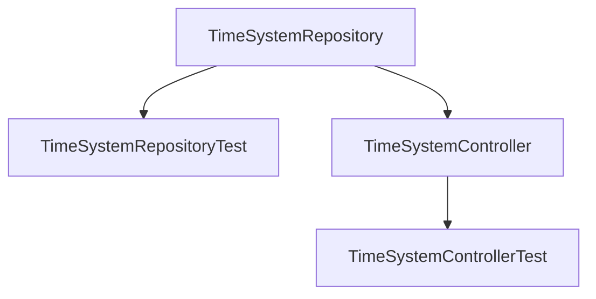

# Topic Name: TimeSystem
# Issue Name: MidnightWrapAround

## 1. Objective
Refactor the `TimeSystemRepository` to resolve the midnight wrap-around issue (handling standard vs. overnight blocks) with eager loading. Implement a read-only endpoint `/api/v1/temporal-blocks` that accepts an optional `?time=` filter and returns flattened JSON blocks.

## 2. Dependency Graph

## 3. Vertically Sliced Task Plan

### Phase 1: Repository Refactoring & Integration Testing
- **Task 1.1: Implement Query Logic**
  - **Path**: `src/Repository/TimeSystemRepository.php`
  - **Action**: Implement `getActiveForTime(?string $timeString = null)` supporting standard and overnight wrap-around blocks, eager loading `tags` and `tagType`. Update `getCurrent()` to invoke `getActiveForTime()`.
- **Task 1.2: Repository Integration Tests**
  - **Path**: `tests/Repository/TimeSystemRepositoryTest.php`
  - **Action**: Implement tests extending `KernelTestCase` with standard blocks, overnight blocks, eager loading checks, and boundary time queries.

### Phase 2: API Endpoint Implementation & Functional Testing
- **Task 2.1: API Controller**
  - **Path**: `src/Controller/Api/TimeSystemController.php`
  - **Action**: Create `GET /api/v1/temporal-blocks` route with format validation, repository call, and dynamic tag grouping.
- **Task 2.2: Controller Functional Tests**
  - **Path**: `tests/Controller/Api/TimeSystemControllerTest.php`
  - **Action**: Create tests extending `WebTestCase` checking valid/invalid time filters, response shape, and status codes.

## 4. Cost Estimates (Industry Standards)
| Phase | Input Tokens | Output Tokens | Est. Cost (USD) |
|---|---|---|---|
| Planning | 15,000 | 2,500 | $0.05 |
| Phase 1: Repository | 20,000 | 1,500 | $0.03 |
| Phase 2: Controller | 25,000 | 2,000 | $0.04 |
| Verification & Ship | 15,000 | 1,000 | $0.02 |
| **Total** | **75,000** | **7,000** | **$0.14** |
